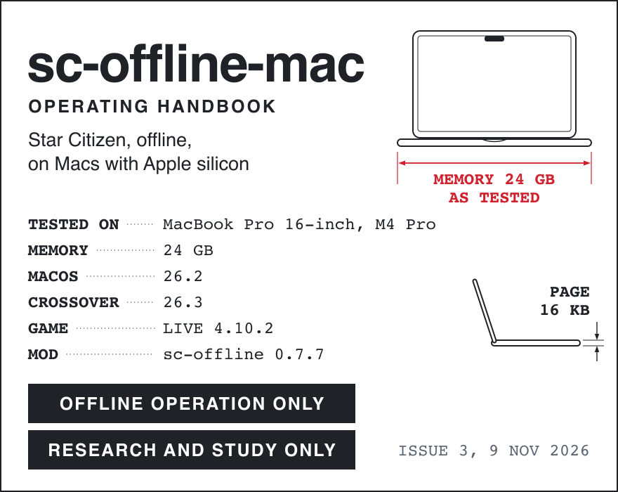
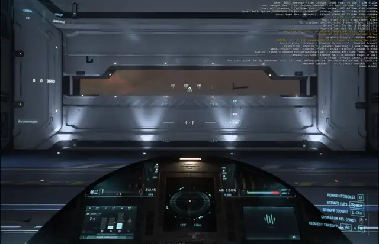
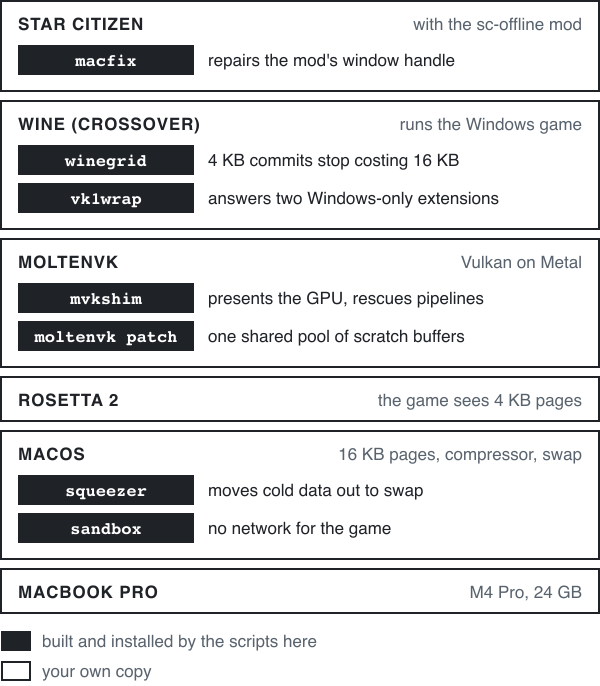
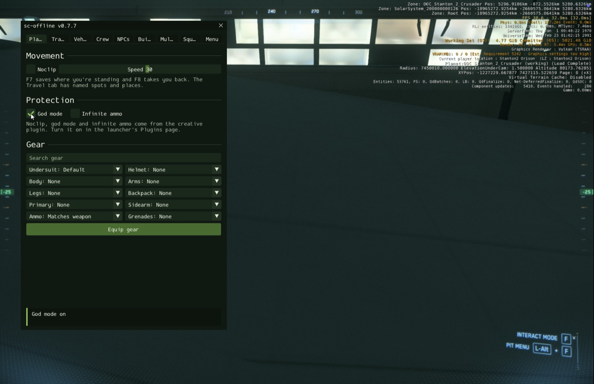
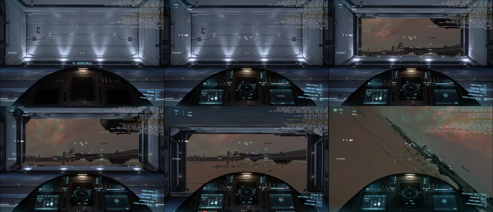
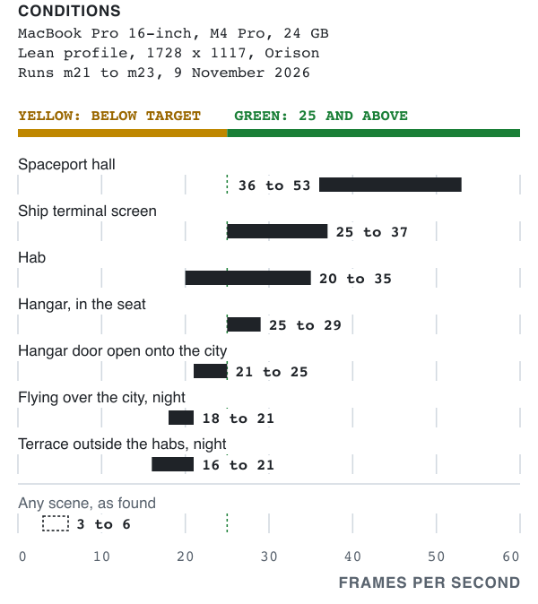
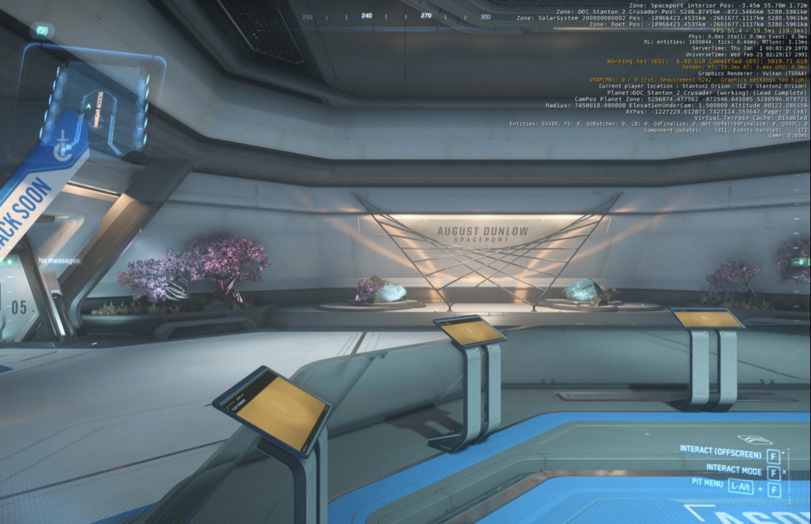
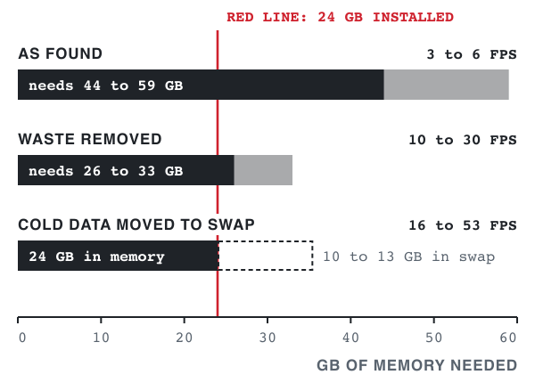

<p>
  <picture>
    <source media="(prefers-color-scheme: dark)" srcset="docs/assets/cover-dark.svg">
    
  </picture>
</p>

A kit of fixes, published as research, for running Star Citizen offline and single-player on Macs with Apple silicon, through Wine and the [sc-offline](https://github.com/scuba-sc/sc-offline) mod. Since Issue 4 [a launcher](#the-launcher) sets everything up, and [CrossOver](https://www.codeweavers.com/crossover) is no longer needed. On the one machine tested so far, a MacBook Pro 16-inch with an M4 Pro and 24 GB, it took the game from 3 to 6 frames per second to 20 to 56 indoors and 16 to 30 with a city in view. The game was failing on memory, not on graphics speed, and the cause is one every Mac with Apple silicon shares: memory comes in 16 KB pages, and the game asks for it 4 KB at a time. This handbook says what the kit does, where its limits are, and [how to set it up](#-normal-procedures).

## Notice

This repository is published for research and education only: a study of why a large Windows program runs out of memory on Apple silicon, what fixes it, and the measurements that show it. It is an unofficial fan project and experimental, home-built work. It is not made, approved or supported by the Cloud Imperium group of companies or Roberts Space Industries. It contains no game files and does not provide the game: you need your own copy. It runs the game offline only, with the network denied to it. The full statement is in [Section 2](#-limitations).

## Performance specifications

| Performance | Measured |
|:--|:--|
| Frame rate indoors: hab, spaceport hall, hangar | **20 to 56 FPS** |
| Frame rate with the city in view: hangar door open, flying over it at night | **16 to 30 FPS** |
| Frame rate as found, before the fixes | 3 to 6 FPS |
| Spaceport hall with the `pretty` profile, against the plain one | 47 to 56 FPS, was 35 to 41 |
| Launch to standing in the world | about 5 minutes |
| Memory the game needs: as found, then now | 44 to 59 GB, then 26 to 33 GB |
| Take-off: clearance from the tower to hangar door open | about 12 seconds |
| Network access of the game process | none: a macOS sandbox profile denies it |

One machine, one evening: a MacBook Pro 16-inch with an M4 Pro and 24 GB, runs m21 to m26, 9 November 2026. No other Mac has been measured yet. Conditions are in [Section 5](#-performance). Those runs used CrossOver. On WineHQ's own build, through the launcher, one view has been compared so far: the hab, 34 to 36 FPS, against 29 to 38 on CrossOver the same day (12 November 2026).

<p align="center">
  
  <br>
  Figure 0-1. Take-off from the Orison hangar at six times real speed. Run m22, 9 November 2026.
</p>

Power on, clearance from the tower, the door opens, lift-off, out over the city at night. The counters in the corner are the game's own. [The video (9 MB)](docs/media/takeoff-preview.mov) plays at real speed.

## Sections

| No. | Section | You will find |
|:-:|:--|:--|
| 1 | [General](#-general) | What is in the kit and where each part sits |
| 2 | [Limitations](#-limitations) | Offline and research only, which Macs it applies to, what was tested, what is not verified |
| 3 | [Emergency procedures](#-emergency-procedures) | The frame rate collapses, the menu ignores the mouse, the game dies while loading |
| 4 | [Normal procedures](#-normal-procedures) | The launcher, or setup by hand with CrossOver; starting the game, the first take-off |
| 5 | [Performance](#-performance) | Frame rates by scene, with conditions, and what each fix gave |
| 6 | [Weight and balance](#-weight-and-balance) | Where the memory goes, before and after |
| 7 | [Systems](#-systems) | How each fix works, its log, how to remove it |
| 8 | [Handling, service and maintenance](#-handling-service-and-maintenance) | After an update of the launcher, CrossOver, the mod or the game |
| 9 | [Supplements](#-supplements) | Test tools, the lab notebook, licence, credits |

## <picture><source media="(prefers-color-scheme: dark)" srcset="docs/assets/tab-1-dark.svg"></picture> General

The kit does not contain the game, Wine or the mod. The launcher fetches Wine, DXVK, the publisher's launcher and the mod from the projects that make them, and you bring your own copy of the game; the sources are listed in [Section 4](#the-launcher). The kit adds eight parts around them. The launcher installs them all; each also has a script of its own and a way to take it out again.

<p align="center">
  <picture>
    <source media="(prefers-color-scheme: dark)" srcset="docs/assets/fig-1-1-systems-dark.svg">
    
  </picture>
  <br>
  Figure 1-1. Where each part sits.
</p>

| Part | What it does | What it gave |
|:--|:--|:--|
| [winegrid](winegrid) | A 4 KB commit stops costing a 16 KB page | A 21 GB heap costs 19 GB of memory, not 35 to 50 |
| [MoltenVK patch](patches) | One shared pool of tessellation scratch buffers | Graphics memory 5.0 GB, not 8.5 to 9 |
| [squeezer](winegrid/balloon.c) | Moves cold compressed data out to swap | Paging under 1,000 per second, was 45,000 |
| [mvkshim](mvkshim) | Presents the graphics chip; swaps rejected pipelines for empty ones | The game starts |
| [vk1wrap](vk1wrap) | Answers two Windows-only Vulkan extensions | The game starts |
| [macfix](macfix) | Repairs the mod's dead window handle | Menu, hotkeys and tower work |
| [launcher](launcher) | An app that sets everything up, starts the game with no network and shows the start and the flight as they happen | One window to set up and play, without CrossOver |
| [start script](sc-offline-mac.sh) | The same start for a CrossOver bottle, from Terminal | One command to play |

Three kinds of notice are used in this handbook, in GitHub's own colours:

> [!CAUTION]
> Ignoring this can break the installation or put the game online.

> [!WARNING]
> Ignoring this costs you time: a crash, a reinstall, a wrong measurement.

> [!NOTE]
> Worth knowing. Nothing breaks if you skip it.

## <picture><source media="(prefers-color-scheme: dark)" srcset="docs/assets/tab-2-dark.svg"></picture> Limitations

**Offline operation only.** The launcher and the start script run the game inside a `sandbox-exec` profile that denies all network access to the game's process tree, and `./sc-offline-mac.sh nettest` proves it from inside Windows. Nothing here is meant for the official servers and nothing here has been used with them.

**Research and study only.** The repository is published to document a problem and its fix: why a large Windows program runs out of memory on Apple silicon, what each change does about it, and the measurements, so that others can study, repeat or correct them. It is experimental, home-built work. Nothing here is for sale and nothing here asks for money. It comes with no warranty. If you run it, you do so at your own risk and under the agreements that bind you, the game's terms of service among them: read them first. Nothing in this handbook is legal advice.

**Your own copy.** The repository holds no game files or assets, no CrossOver or Wine binaries and no copy of the mod, and neither does the launcher: it downloads Wine, DXVK and the mod from their own projects and the publisher's launcher from the publisher. It does not provide the game: you need your own copy, installed with the publisher's launcher under your own account. This is an unofficial fan project. It is not affiliated with or endorsed by the Cloud Imperium group of companies or Roberts Space Industries. The screenshots and the take-off recording show the game, whose imagery belongs to its publisher (© Cloud Imperium Rights LLC and Cloud Imperium Rights Ltd.). They are shown without charge, as evidence for the measurements. If you hold rights in anything shown here and want it changed or removed, [open an issue](https://github.com/GUNNA-at/sc-offline-mac/issues).

**For Macs with Apple silicon.** The fault this kit fixes comes from the 16 KB page, and every Mac with Apple silicon has it, MacBook or desktop, whichever chip is in it. Nothing in the scripts or the code is tied to one model. The kit has run on one machine only, so on every other Mac it is untested, and the memory installed decides how much of the game's load goes to swap ([Section 6](#-weight-and-balance)). Macs with Intel processors are outside its scope: their pages are 4 KB, the fault does not arise, and nothing here was tried on one. If you run the kit on another Mac, [report what you found](https://github.com/GUNNA-at/sc-offline-mac/issues/new?template=tested-mac.yml): each report becomes a tested configuration.

**One tested configuration.** Every number in this handbook comes from the machine below. Nothing else has been tried.

| Item | As tested |
|:--|:--|
| Machine | MacBook Pro 16-inch, M4 Pro, 24 GB |
| macOS | 26.2 |
| CrossOver | 26.3 (Wine with MSync on, D3DMetal off): every figure of Section 5 |
| Wine without CrossOver | WineHQ 11.0, the official Mac build, with DXVK for macOS 1.10.3, through the launcher: one view compared |
| Game | LIVE 4.10.2, build 4.10.197.2878, Vulkan renderer |
| Mod | sc-offline 0.7.7, `boot_map = PU` (the Stanton system only) |
| MoltenVK | 1.4.2, patched |
| Display mode | 1728 x 1117, scaled up by macOS |
| Disk | 146 GB for the game, 10 to 14 GB of swap while playing; keep 20 GB free |

**Version locks.**

- macfix works by address inside the mod's `dinput8.dll` 0.7.7. On any other build it checks, logs that it found something else, and does nothing.
- A CrossOver update replaces the patched `ntdll.so` and MoltenVK. Run the install scripts again ([Section 8](#-handling-service-and-maintenance)).
- The launcher takes WineHQ 11.0_1 and DXVK 1.10.3 and no other version, each checked against its published checksum.

**Not verified.**

- The scenes of Section 5 on WineHQ's build. Only the hab view was compared with CrossOver.
- The game's download through the launcher after sign-in. The test machine had the game already and no room for a second copy; every step before it was run in a fresh folder.
- Any other Mac. After the fixes the game still asks for 26 to 33 GB, so with less than 24 GB expect heavy paging or a failure to load, and with more it should be easier. Neither has been measured.
- Landing, and returning to a hangar.
- Sessions longer than a few hours.
- More than one star system loaded (`boot_map = PU_All` carries 2.6 million entities instead of 1.6 million).

> [!CAUTION]
> Never press **Launch Game** in the RSI Launcher. It installs the anti-cheat service and takes the game online. Use the publisher's launcher only to install, verify and update the game.

> [!WARNING]
> Never run `sample` or `vmmap` on the game. They freeze the process long enough for the engine to declare a hung graphics device and exit. `footprint`, `top`, `vm_stat` and `ps -M` are safe.

## <picture><source media="(prefers-color-scheme: dark)" srcset="docs/assets/tab-3-dark.svg"></picture> Emergency procedures

<picture>
  <source media="(prefers-color-scheme: dark)" srcset="docs/assets/hatch-dark.svg">
  
</picture>

```
FRAME RATE FALLS TO 2 TO 5 FPS
after a door opens or a teleport
1. Wait ................. 20 TO 60 SEC
2. Squeezer log ................ CHECK
3. No squeeze logged ......... SQUEEZE
```

The squeezer reacts by itself once paging builds up. Its log is `/private/tmp/sc-squeezer.log`. One squeeze by hand:

```bash
./sc-offline-mac.sh squeeze
```

```
MENU (M) IGNORES THE MOUSE,
OR THE TOWER DOES NOT ANSWER
1. macfix log .................. CHECK
2. "sc-offline 0.7.7 found" .. PRESENT
3. "ran N times/s" ........ 15 OR MORE
4. Mod was updated ......... SECTION 8
```

The log is `C:\users\crossover\macfix.log` in the bottle.

```
THE GAME EXITS WHILE LOADING
1. Shim log .................... CHECK
2. Game log .................... CHECK
3. Watchdog lines ........ IN user.cfg
4. Other applications ........... QUIT
```

The shim logs to `/private/tmp/mvkshim.log`, the game to `LIVE\Game.log`. The watchdog lines are the first block of [`config/user.cfg.example`](config/user.cfg.example). The game needs every gigabyte: quit what else is running and start again.

```
TELEPORT DROPPED YOU THROUGH A FLOOR
1. God mode ....................... ON
2. Go .................... PRESS AGAIN
```

The room had not loaded when you arrived. God mode is in the mod's menu, Player tab.

```
SHIP IS POWERED BUT DOES NOT MOVE
1. Thrusters .................. ON (I)
```

## <picture><source media="(prefers-color-scheme: dark)" srcset="docs/assets/tab-4-dark.svg"></picture> Normal procedures

There are two ways to set this up. The launcher does it by itself and needs neither CrossOver nor Homebrew. The procedure by hand is the one the figures of Section 5 were measured with; it needs CrossOver, and it is kept for anyone who wants each step in their own hands. Either way, allow an evening, most of it the game download.

### The launcher

<p align="center">
  
  <br>
  Figure 4-1. The launcher, set up and ready, version 0.1.1. In flight the bar under the status shows the game's memory against the Mac's: six minutes after Single player was pressed on the test machine it read 26.8 GB held on a Mac with 24, at 30 FPS. 12 November 2026.
</p>

```
Mac .................... APPLE SILICON
Free disk ..................... 200 GB
Launcher .................... DOWNLOAD
Download mark ................. REMOVE
Set up ......................... PRESS
Rosetta, if asked ..... AGREE YOURSELF
Publisher's launcher ......... SIGN IN
Install, in that launcher ...... PRESS
Launch Game button ............. NEVER
Single player .................. PRESS
```

Download `sc-offline-mac.app.zip` from [the latest release](https://github.com/GUNNA-at/sc-offline-mac/releases/latest) and unpack it. The app is not signed with an Apple developer certificate, so macOS refuses to open it while it carries the mark of a download. Remove the mark once:

```bash
xattr -dr com.apple.quarantine ~/Downloads/sc-offline-mac.app
```

Then open it and press Set up. The launcher fetches each part from the project that makes it and checks every file against its published checksum.

| Part | Comes from |
|:--|:--|
| Wine 11.0 | [WineHQ's official Mac package](https://github.com/Gcenx/macOS_Wine_builds/releases/tag/11.0_1), 177 MB |
| DXVK 1.10.3 | [DXVK for macOS](https://github.com/Gcenx/DXVK-macOS/releases/tag/v1.10.3-20230507-repack), 3 MB |
| RSI Launcher | [the publisher's download site](https://robertsspaceindustries.com/en/download), 346 MB |
| sc-offline 0.7.7 | [the mod's release](https://github.com/scuba-sc/sc-offline/releases/tag/v0.7.7), 3 MB |
| The kit's own parts | inside the app |
| The game | the publisher's launcher, with your own account |

It stops where the step is yours:

- **Rosetta 2**, if the Mac does not have it. Apple asks you to agree to its licence, so the launcher opens Terminal with the command typed and waits.
- **The publisher's launcher.** You sign in, you accept its terms, and you press Install there. The launcher shows the download and carries on when you close that window.
- **A game the Mac already has.** If one is found in a CrossOver bottle on the same disk, the launcher offers to move it into its own folder: a rename, nothing is copied, and a link stays behind for the bottle.

Everything it sets up is in `~/Library/Application Support/sc-offline-mac`. Nothing is installed anywhere else, and no file of Wine is changed. To remove it all, delete that folder and the app. If the launcher moved your game there, the game goes with the folder.

The same program answers in Terminal, with one line of JSON per event:

```bash
sc-offline-mac.app/Contents/MacOS/sc-offline-mac status
sc-offline-mac.app/Contents/MacOS/sc-offline-mac setup
sc-offline-mac.app/Contents/MacOS/sc-offline-mac play
```

Multiplayer is on the window, marked Soon and switched off. Nothing behind it exists yet.

### By hand, with CrossOver

These are the steps that were done on the test machine before the launcher existed, in the order that works.

#### Before you start

```
Mac .................... APPLE SILICON
Memory ............... 24 GB AS TESTED
Free disk ..................... 200 GB
CrossOver ....................... 26.3
Xcode ...................... INSTALLED
Homebrew packages .......... INSTALLED
Star Citizen ........... YOUR OWN COPY
sc-offline mod ................. 0.7.7
```

```bash
brew install mingw-w64 vulkan-headers sevenzip
```

The memory line is the test machine's, not a tested minimum. What to expect with more or less is in [Section 6](#-weight-and-balance).

The kit contains no copy of the mod, CrossOver or Wine. These are their official sources.

| Item | Official source |
|:--|:--|
| sc-offline mod | [Release 0.7.7](https://github.com/scuba-sc/sc-offline/releases/tag/v0.7.7) of [sc-offline](https://github.com/scuba-sc/sc-offline) by scuba-sc, on GitHub |
| CrossOver | [CodeWeavers](https://www.codeweavers.com/crossover), its maker |
| Wine | [WineHQ](https://www.winehq.org/), the project's home. CrossOver already contains it |

Take `sc-offline-v0.7.7.zip` from the mod's release, not GitHub's source code archive. macfix is tied to that version ([Section 2](#-limitations)).

CrossOver is a paid product with a free trial. Wine needs no download of its own here: CrossOver contains its own build, that build is the one these scripts patch, and CodeWeavers publishes [its source](https://www.codeweavers.com/crossover/source). The scripts of this procedure expect CrossOver in the Applications folder. Without CrossOver, use the launcher: it runs the game on WineHQ's own build.

#### The bottle and the game

```
Bottle "StarCitizen" .......... CREATE
Windows version ........... 11, 64-BIT
MSync ............................. ON
D3DMetal ......................... OFF
RSI Launcher ......... UNPACK, NOT RUN
sc-launcher.sh ................... RUN
Sign in ..................... YOURSELF
Game, LIVE channel ........... INSTALL
Launch Game button ............. NEVER
```

> [!WARNING]
> Do not run the publisher's installer. It does not complete under CrossOver or Wine. On the test machine it stopped at the step that asks Windows for administrator rights. On another Mac it said the RSI Launcher was running and could not be closed, however often Retry was pressed ([issue 1](https://github.com/GUNNA-at/sc-offline-mac/issues/1)).

Unpack the installer instead. What matters in it is one archive, `app-64.7z`, with the RSI Launcher's own files. They go where the installer would have put them:

```bash
7zz x "RSI Launcher-Setup-2.19.2.exe" -orsi-setup
```

```bash
7zz x "$(find rsi-setup -name app-64.7z)" -o"$HOME/Library/Application Support/CrossOver/Bottles/StarCitizen/drive_c/Program Files/Roberts Space Industries/RSI Launcher"
```

Both commands were run on the test machine on 12 November 2026 with installer 2.19.2: 489 files, 709 MB, the same set of files as the copy the test machine has used since 8 November, which was put in place this way from 2.19.1. The archive is byte for byte the one the launcher app cuts out of the installer, so the app does the same by itself and needs no 7-Zip. The installer also carries three background videos outside the archive, 112 MB. Neither way installs them, and the RSI Launcher has worked without them. Not checked: a start of the 2.19.2 copy under CrossOver. Under WineHQ 11.0 it draws its sign-in page.

The RSI Launcher draws a white window under CrossOver unless it is started with the flags in [`sc-launcher.sh`](sc-launcher.sh).

#### The mod

```
sc-offline 0.7.7 .............. UNPACK
boot_map .......................... PU
Game path ........................ SET
```

Unpack `sc-offline-v0.7.7.zip` from [the mod's release](https://github.com/scuba-sc/sc-offline/releases/tag/v0.7.7) to `C:\users\crossover\sc-offline` in the bottle. [`config/sc-offline.ini.example`](config/sc-offline.ini.example) shows the values used.

#### The graphics layer

```
Patched MoltenVK ...... BUILD, INSTALL
mvkshim ............... BUILD, INSTALL
vk1wrap ............... BUILD, INSTALL
```

```bash
patches/install-moltenvk.sh
mvkshim/build-and-install.sh
vk1wrap/build-and-install.sh
```

#### The memory layer

```
winegrid ..................... INSTALL
Bottle environment ............... SET
```

```bash
winegrid/install.sh
```

The environment goes into the bottle's `cxbottle.conf`; [`config/cxbottle-environment.example`](config/cxbottle-environment.example) has the lines.

#### Game settings

```
user.cfg ........................ COPY
Profile ....................... PRETTY
```

Copy [`config/user.cfg.example`](config/user.cfg.example) to `LIVE\user.cfg`, then:

```bash
./sc-offline-mac.sh profile pretty
```

#### The mod's helper

```
macfix ....................... INSTALL
Creative plugin ............ SWITCH ON
```

```bash
macfix/install.sh
```

The mod ships its creative plugin (god mode, noclip) switched off, and the switch is in its Windows launcher. Deleting the file `data\plugins\creative\disabled` in the mod's folder is all that switch does.

<p align="center">
  
  <br>
  Figure 4-2. The mod's menu with God mode ticked. Run m22, 9 November 2026.
</p>

### Starting

In the launcher, press Single player. By hand:

```bash
./sc-offline-mac.sh play
```

```
First window ................ 1 MINUTE
Information boxes ... CLOSE THEMSELVES
In the world ............... 5 MINUTES
Leave the bed ................. HOLD Y
Mod menu ........................... M
```

### First take-off

<p align="center">
  
  <br>
  Figure 4-3. Six moments of the take-off. Run m22, 9 November 2026.
</p>

```
Travel, saved spot .... SHIP TERMINALS
Ship terminal ............... RETRIEVE
Pilot seat ....................... SIT
Power ......................... ON (U)
Thrusters ..................... ON (I)
Tower ............ HOLD L-ALT, PRESS N
Hangar door ........... OPEN IN 12 SEC
Lift ................... SPACE, THEN W
```

> [!NOTE]
> The terminal lists some ships several times under one name. Take the first row of a group: the others arrive with a computer-controlled pilot already in the seat.

> [!NOTE]
> In the measured take-offs the ship was powered through the mod's `crew.power_on` command, and the thrusters were still off afterwards. `U` is the game's default key for power and was not pressed in those runs.

## <picture><source media="(prefers-color-scheme: dark)" srcset="docs/assets/tab-5-dark.svg"></picture> Performance

<p align="center">
  <picture>
    <source media="(prefers-color-scheme: dark)" srcset="docs/assets/fig-5-1-frame-rate-dark.svg">
    
  </picture>
  <br>
  Figure 5-1. Frame rate by scene, lean profile. Runs m21 to m23, 9 November 2026.
</p>

**Conditions.** MacBook Pro 16-inch, M4 Pro, 24 GB. Lean profile ([`profiles/lean.cfg`](profiles/lean.cfg)), 1728 x 1117, vertical sync off, Orison. Runs m21 to m23, 9 November 2026, read from the game's own counter.

| Scene | FPS |
|:--|:--|
| Spaceport hall | 36 to 53 |
| Ship terminal screen | 25 to 37 |
| Hab | 20 to 35 |
| Hangar, in the pilot seat | 25 to 29 |
| Hangar door open onto the city | 21 to 25 |
| Flying over the city, night | 18 to 21 |
| Terrace outside the habs, night | 16 to 21 |

<p align="center">
  
  <br>
  Figure 5-2. The spaceport hall at 51 frames per second. Run m23, 9 November 2026.
</p>

**Notes.**

1. Right after a hangar door opens onto the city, or after a jump across it, the frame rate falls to 2 to 5 for a short while until the squeezer has made room.
2. Night is heavier than day: more lights are drawn. The game's clock runs about six times real time, so the same view is day in one launch and night in the next. Do not compare launches without reading the clock.
3. The target is 25 and above everywhere. The city views sit at or just under it.
4. With the city in view the frame is bound by the game's own main thread: 44 to 51 ms, 16 to 20 of them spent syncing with the offline mod's built-in server (3 ms indoors). Graphics settings barely move it, and nothing in the kit touches it.
5. A jump to another planet costs a minute or more at 2 to 3 FPS.

**What each step gave.**

| Step | Runs | Calm | City |
|:--|:--|:--|:--|
| As found | m1, m2, m10 | 3 to 6 | – |
| winegrid | m11 to m13 | 25 to 30 | 10 to 15 |
| Lean profile, sync off | m14, m15 | 31 to 35 | 8 to 15 |
| Patched MoltenVK | m18, m19 | – | 14 to 29 |
| Squeezer | m20 | – | 25 to 31 |
| Final plugin, lean profile | m21 to m23 | 20 to 35 | 16 to 25 |
| `pretty` profile, upscaler at Quality | m25, m26 | 45 to 56 | 22 to 30 |

Calm is a room with no city in view; City is a view with the city in it. A dash means not measured. The 3 in the first row is the owner's own first session, before run m1; the squeezer's 25 to 31 was a light city view; the last row is the spaceport hall and the terrace outside the habs.

**The upscaler and the `pretty` profile.** The game's own upscaler renders fewer pixels and reconstructs the picture. The game refuses that setting in `user.cfg`; macfix sets it (Section 7). Indoors, where the graphics chip is the limit, it buys a quarter to a third more frames, and the `pretty` profile spends part of that on better shading, shadows, textures and post-processing.

| Spaceport hall, switched in a running game | FPS |
|:--|:--|
| Lean profile, native resolution | 37 |
| Lean, upscaler at Quality (66%) | 46 |
| Lean, upscaler at Balanced (57%) | 49 |
| Lean, upscaler at Performance (50%) | 50 |
| `pretty` profile (upscaler at Quality) | 45 |
| `pretty` profile from a cold start | 47 to 56 |

With the city in view the same switch read 23 to 25 for `pretty` against 22 to 23 for lean, and 24 to 30 from a cold start. Runs m24 to m26, 9 November 2026.

## <picture><source media="(prefers-color-scheme: dark)" srcset="docs/assets/tab-6-dark.svg"></picture> Weight and balance

An aircraft handbook has a chapter on how much the machine may carry and where. For a Mac the load is memory, and the limit is what is installed: 24 GB in the machine tested.

<p align="center">
  <picture>
    <source media="(prefers-color-scheme: dark)" srcset="docs/assets/fig-6-1-loading-dark.svg">
    
  </picture>
  <br>
  Figure 6-1. Loading graph of the test machine. Runs m10 to m23, 9 November 2026.
</p>

**Why it was overloaded.** Under Rosetta the game works in 4 KB pages; the Mac's memory comes in 16 KB pages. Wine commits memory the way Windows programs ask for it, and this game asks for its heap one 4 KB page at a time. Each of those pieces ended up as its own kernel object, rounded up to 16 KB. A million of them turned 21 GB of data into 35 to 50 GB of demand.

**Loading table.**

| GB of memory | As found | Now |
|:--|:--|:--|
| The game's heap, as the kernel charges it | 35 to 50 | 19 to 22 |
| Graphics memory, wired | 8.5 to 9 | 5.0 |
| Compressed data held in memory | 7.5 to 9 | 3.3 to 3.6 |
| Live, uncompressed data | 4.4 | 7.5 |
| Page decompressions per second | 160,000 to 218,000 | under 1,000 |

The game still needs 26 to 33 GB, more than the test machine has. About 14 GB of that is the offline mod running the whole star system's server-side state, which the game writes once and never reads again. The squeezer puts that part in swap, where it costs disk instead of memory.

**Other Macs.** The 16 KB page is the same on every Mac with Apple silicon, so the waste is the same and so is the fix. What moves is the red line: it sits at the memory installed. The test machine carries 24 GB in memory and 10 to 13 GB in swap, 34 to 37 GB in all. By arithmetic alone, a Mac with 48 GB or more should hold all of that in memory, one with 32 or 36 GB nearly all, and one with 16 GB under half, where the game may be too slow to play or may not load. None of this has been measured: every number in this section is one machine's.

## <picture><source media="(prefers-color-scheme: dark)" srcset="docs/assets/tab-7-dark.svg"></picture> Systems

### winegrid

Wine reserves address space with an anonymous mapping and commits pieces of it later. On macOS the kernel creates the memory object for such a mapping at the first touch, sized to whatever piece is being touched, so every separately committed piece becomes its own object and is rounded up to a 16 KB page. `libwinegrid.dylib` is loaded into Wine before the first reservation and redirects `mmap` and `munmap` inside `ntdll.so`: a reservation becomes a mapping of named memory objects, 128 MB each, and committing a 4 KB piece then costs 4 KB. `winegrid/kt.c` reproduces the problem without Wine: 1 GB of data costs 4 GB one way and 1 GB the other.

Active only when the bottle's environment has `WINEGRID=1`. Log: `/private/tmp/winegrid.log`. Remove: [`winegrid/remove.sh`](winegrid/remove.sh).

### The MoltenVK patch

Metal has no tessellation shaders, so MoltenVK runs those stages as compute passes into temporary buffers of 2, 4 and 8 MB. Each Vulkan command pool kept its own set and reused the oldest first; the game records from dozens of pools, so about 3,700 buffers, 5 to 6 GB, appeared whenever a planet was in view. The patch gives the device one shared set and reuses the newest first: 507 buffers, 1.9 GB.

Source: [`patches/`](patches). Remove: put back the unpatched build, kept beside it as `libMoltenVK.real.dylib.khronos-1.4.2`.

A second patch adds two code paths that can be switched while the game runs: tessellation compute queued ahead of its render pass (the pass is then interrupted once instead of once per tessellated draw: 22 restarts a frame became 2.5), and queue submissions encoded off the game's render thread. Both work and neither changed the frame rate, because the views that are slow are not limited there. They are off unless switched on with [`tools/live.sh`](tools/live.sh).

### mvkshim

A small library that sits in front of MoltenVK. It reports the graphics chip as a discrete card, which the game insists on, and advertises a few features the game demands and then never needs. When Apple's shader compiler rejects one of the game's pipelines (a handful of water and particle variants do this every time), it builds an empty pipeline in its place so those few effects draw nothing instead of ending the game.

Log: `/private/tmp/mvkshim.log`. Remove: [`mvkshim/remove-shim.sh`](mvkshim/remove-shim.sh).

### vk1wrap

A `vulkan-1.dll` for the Windows side that answers two Windows-only extensions the game asks for and passes everything else to Wine's own.

Remove: restore `system32\vulkan-1.dll.wine-fake` and delete the `vulkan-1` override in the bottle.

### The squeezer

Under pressure macOS lets compressed memory fill about 60% of what is not wired before it writes any of it to swap. The game's never-touched data therefore sat in memory, compressed, while its live data went in and out of the compressor every frame. `winegrid/balloon` pins a few gigabytes for a few seconds; the kernel answers by moving its oldest compressed data to swap, and it stays there. `balloon auto` does this when compressed memory exceeds 5 GB and paging passes 10,000 decompressions per second. Both thresholds are constants in [`winegrid/balloon.c`](winegrid/balloon.c), chosen on the 24 GB test machine and not tuned for any other amount of memory.

Log: `/private/tmp/sc-squeezer.log`. Off: `SC_NO_SQUEEZE=1 ./sc-offline-mac.sh play`.

### macfix

The mod finds the game's window one second after start and keeps the handle. Under CrossOver the game recreates its window while loading, so the mod was posting its wake-up messages to a window that no longer existed, and its own code ran zero times per second unless the mouse happened to move. The menu looked dead, hotkeys missed presses, and the step that makes you the owner of your hangar pad lost a race, so the tower queued every take-off request forever. macfix finds the live window, repairs the mod's handle and keeps the wake-ups coming. It also runs mod commands from a file, which is how the test flights in this handbook were flown without hands on the keyboard.

Switches: `C:\users\crossover\macfix.ctl`. Log: `C:\users\crossover\macfix.log`. Remove: delete `data\plugins\macfix` in the mod's folder.

### The launcher

One program, in [`launcher/`](launcher): the setup and start logic in `Sources/Engine.swift`, a window that shows it, and the same commands in Terminal. It leaves Wine as downloaded. The kit's libraries are found through `DYLD_LIBRARY_PATH` and winegrid is loaded with `DYLD_INSERT_LIBRARIES`, so there is no patched `ntdll.so` to redo after an update. It starts the game inside the same `sandbox-exec` profile as the start script, presses OK on the game's start-up boxes with [`tools/dismiss.c`](tools/dismiss.c), runs the squeezer once the world is up, and takes the mod out of the game folder after every stop. It refuses to open the publisher's launcher while the game runs.

Wine without CrossOver needed four things that CrossOver supplies without saying so: Rosetta asked to report AVX (`ROSETTA_ADVERTISE_AVX=1`), DXVK so that Direct3D 11 can name a graphics adapter (the game asks Direct3D which adapter to use and then draws with Vulkan), the same adapter identity on both sides, and two features the shim now advertises so that DXVK grants feature level 11.1. The notebook entry of 12 November gives each failure with its message.

The window shows what the machine reports: the stage of a start from `Game.log`, the frame rate from the shim's log against the 25 FPS target, and the game's memory on a bar with a mark where the memory installed ends. Its backdrop is a photograph from NASA's open archives, credited on the panel: three come with the app and Settings switches between them, or takes a picture of your own, which stays on your Mac. Build: `launcher/build.sh`.

Logs: `~/Library/Application Support/sc-offline-mac/logs`. Remove: delete `~/Library/Application Support/sc-offline-mac` and the app.

### The start script and the sandbox

`./sc-offline-mac.sh play` starts the mod's own launcher inside a `sandbox-exec` profile that denies network access to everything it starts, then a dialog dismisser, a crash watcher and the squeezer. `nettest` shows a Windows process inside the same sandbox failing to open a connection or resolve a name.

### Live settings

The mod keeps a pointer to the game's console for its own use. macfix borrows it, so the game's settings can be read and changed while it runs, including the ones `user.cfg` refuses:

```bash
tools/modcmd.sh "!cvar r.TSR.UpscalingPreset"
tools/modcmd.sh "!cvar r.TSR.UpscalingPreset 1"
tools/fps.sh 15
```

The first line reads a setting, the second sets it, the third reports the frame rate, draws and graphics load over the next 15 seconds. Settings that should stay go into `C:\users\crossover\macfix.cvars`, one `name value` per line: macfix sets them once the world has loaded and again whenever the game puts one back.

### Graphics profiles

`./sc-offline-mac.sh profile <name>` selects a profile for the next launch. Each has a part for `LIVE/user.cfg` and, where needed, a part for `macfix.cvars`.

| Profile | What it is | Spaceport hall |
|:--|:--|:--|
| `pretty` | Lean distances and pools; shading, shadows, textures and post-processing raised; upscaler at Quality | 47 to 56 FPS |
| `fast` | Lean, upscaler at Balanced | 49 FPS |
| `lean` | Below the game's Low on draw distance and model detail, native resolution | 35 to 41 FPS |
| `low` | The game's own Low | not measured |

## <picture><source media="(prefers-color-scheme: dark)" srcset="docs/assets/tab-8-dark.svg"></picture> Handling, service and maintenance

```
AFTER A LAUNCHER UPDATE
1. New app ...................... OPEN
2. Kit parts ........... SHOWN NOT YET
3. Set up ...................... PRESS
```

The launcher's own parts carry its version. A newer app shows them as not yet set and replaces them. Wine and DXVK stay as they are.

```
AFTER A CROSSOVER UPDATE
1. winegrid .................. INSTALL
2. Patched MoltenVK .......... INSTALL
3. mvkshim ................... INSTALL
4. winegrid log ........... SAYS "on:"
```

An update replaces the patched `ntdll.so` and MoltenVK. Run the three install scripts of Section 4 again, then check that `/private/tmp/winegrid.log` says `on:` for `StarCitizen.exe`.

```
AFTER A MOD UPDATE
1. macfix log ................... READ
2. Offsets in macfix.c .......... REDO
3. macfix .................... INSTALL
```

The log names the build macfix found. The method for finding the offsets again is in the notebook, entry of 9 November, 15:05.

```
AFTER A GAME UPDATE
Not tried.
```

Expect to repeat the pipeline and whitelist checks recorded in the notebook. With the launcher, the publisher's launcher opens from the Settings page for the update itself.

```
REMOVING EVERYTHING
1. winegrid ................... REMOVE
2. mvkshim .................... REMOVE
3. CrossOver's MoltenVK ...... RESTORE
4. vulkan-1.dll .............. RESTORE
5. Mod ..................... UNINSTALL
```

```bash
winegrid/remove.sh
mvkshim/remove-shim.sh
./sc-offline-mac.sh uninstall
```

CrossOver's own MoltenVK was kept as `libMoltenVK.dylib.cx-26.3.0` beside the others: rename it back to `libMoltenVK.dylib`. Wine's `vulkan-1.dll` was kept as `system32\vulkan-1.dll.wine-fake`: copy it back and delete the `vulkan-1` override in the bottle.

**Logs.**

- Game: `LIVE\Game.log`
- Mod: `data\mod.log` in the mod's folder
- macfix: `C:\users\crossover\macfix.log`
- winegrid: `/private/tmp/winegrid.log`
- MoltenVK shim: `/private/tmp/mvkshim.log`
- Squeezer: `/private/tmp/sc-squeezer.log`
- Start script: `sc-offline-mac.log` in the bottle's folder
- Launcher: `~/Library/Application Support/sc-offline-mac/logs`

## <picture><source media="(prefers-color-scheme: dark)" srcset="docs/assets/tab-9-dark.svg"></picture> Supplements

### Flying it from a script

The test flights were flown by script: mod commands through macfix, keys and pointer through Wine.

```bash
tools/modcmd.sh "creative.god on"
tools/modcmd.sh "?list"
tools/keys.sh 300 M:80
tools/look.sh shot1
tools/rec out.mov 120
tools/bench.sh terrace
tools/live.sh tess-prepass on
```

In order: run a mod command and print its reply, list every command the mod offers, bring the game forward and press M, take a screenshot with the pointer in it, record the screen for 120 seconds, put the character at a fixed spot and heading for comparisons, flip one of the patched MoltenVK's switches.

macfix adds its own commands for testing: `!pose`, `!find <entity>`, `!goto <entity>`, `!tp <zone> x y z`, `!seats <ship>`, `!sit <ship>`, `!power <ship>`, `!cvar <name> [value]`, `!exec <console line>`. The recipe from ship terminal to open sky is in the notebook.

### The lab notebook

[`docs/NOTEBOOK.md`](docs/NOTEBOOK.md) is the dated record: every run, every number, and the dead ends with the measurement that closed them. [`runs/`](runs) holds the per-run logs, one line every 30 seconds.

### The figures

The cover and figures are drawn by [`docs/assets/src/build.py`](docs/assets/src/build.py) from the numbers in that file.

### Licence and credits

GPL-3.0, see [`LICENSE`](LICENSE). The mod's plugin interface requires it of plugins, and macfix is one. The licence covers what was written for this repository. The game imagery in [`docs/media`](docs/media) is not ours to license. Neither are the three photographs on the launcher's Play page: they come from NASA's open archives, and their sources, credits and terms are in [`launcher/ui/art/CREDITS.md`](launcher/ui/art/CREDITS.md). The [Notice](#notice) says why the work is published; it adds no condition to the licence.

This work stands on [sc-offline](https://github.com/scuba-sc/sc-offline) by scuba-sc, [MoltenVK](https://github.com/KhronosGroup/MoltenVK) by the Khronos Group, [DXVK](https://github.com/doitsujin/dxvk) in [its build for macOS](https://github.com/Gcenx/DXVK-macOS), and [Wine](https://www.winehq.org/), both in [WineHQ's Mac packages](https://github.com/Gcenx/macOS_Wine_builds) built by Gcenx and as shipped in [CrossOver](https://www.codeweavers.com/crossover) by CodeWeavers. Star Citizen, Roberts Space Industries and Cloud Imperium are trademarks of the Cloud Imperium group of companies. Mac, macOS, CrossOver, Wine, Vulkan, Windows and the other product names in this handbook are trademarks of their respective owners. The launcher's backdrops are photographs by NASA (one of them by the astronaut Don Pettit) and by NASA, ESA, CSA and STScI. This project is not affiliated with any of them, and none of them has approved it.

### Log of revisions

| Issue | Date | Change |
|:--|:--|:--|
| 1 | 9 November 2026 | First issue |
| 2 | 9 November 2026 | Live settings, the upscaler and the `pretty` profile; a second MoltenVK patch that changed nothing measurable and is off by default |
| 3 | 9 November 2026 | Scope stated: for Macs with Apple silicon, tested on one. Purpose stated: research and study only. Official sources of the mod, CrossOver and Wine listed |
| 4 | 12 November 2026 | CrossOver no longer needed: the game runs on WineHQ's own Mac build. A launcher sets everything up and starts the game |
| 5 | 12 November 2026 | The launcher's backdrop is a photograph from NASA's open archives in place of a drawing; three come with the app, version 0.1.1 |
| 6 | 12 November 2026 | By hand: the publisher's installer is unpacked, not run. It does not complete under CrossOver or Wine, as the first report from another Mac showed ([issue 1](https://github.com/GUNNA-at/sc-offline-mac/issues/1)) |
